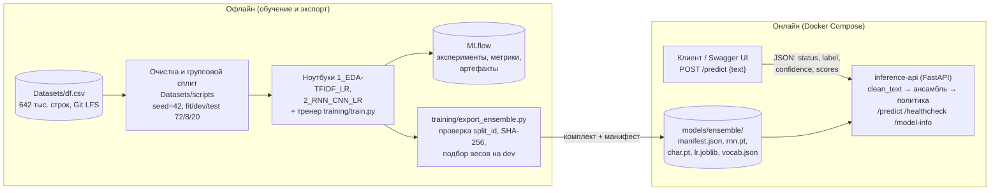
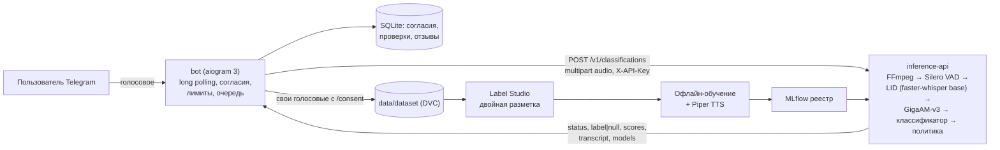

# Архитектура SpamClickbaitClassification

Итоговая защита. Документ описывает **реализованную сейчас** текстовую часть и **целевую**
голосовую систему (концепт v2 после ревью). Полные исходные документы:
`ConceptAndArchitecture/после ревью/ConceptAndArchitecture/v2/02-final-concept.md`,
`03-final-architecture.md`, `04-service-contract.openapi.yaml`.

## 1. Задача и границы

Telegram-бот принимает голосовое сообщение и отвечает: «🚫 Спам», «🎣 Кликбейт»,
«✅ Обычное» или «🤔 Не уверен». Бизнес-ценность — сократить ручной просмотр
нежелательных сообщений. Классы: `normal` (0), `spam` (1), `clickbait` (2);
`uncertain` — статус отказа политики, не четвёртый класс.

**Реализовано:** текстовый классификатор (ансамбль BiGRU+attention / char-CNN / TF-IDF-LR),
FastAPI-сервис `inference-api` в Docker, воспроизводимый тренер и экспорт ансамбля,
очистка/сплиты датасета, MLflow-эксперименты, 84 теста сервиса + тесты данных.
**Не реализовано (план):** ASR-конвейер (GigaAM-v3 + Silero VAD + LID), Telegram-бот (aiogram),
аудиоэндпоинт `/v1/classifications`, TTS-обогащение, калибровка, voice-holdout.

## 2. Схема: что работает сейчас

PNG-версия для отчёта и презентации: `architecture.png` (рядом с этим файлом).

## 3. Целевая схема (концепт v2)

## 4. Компоненты и обоснование решений

| Компонент | Технология | Почему так |
|---|---|---|
| Классификатор | Ансамбль: BiGRU+attention (0.5), char-CNN (0.2), TF-IDF word+char → LR (0.3) | RNN понимает контекст, CNN — символьные шаблоны/опечатки, LR — устойчивая линейная база на разреженных признаках. Веса подобраны на dev, test оценён один раз. Ансамбль снижает риск единственной модели |
| Альтернатива «только LR» | TF-IDF + LogisticRegression | Дешёвый воспроизводимый baseline (тренер `training/train.py`, конфиги baseline/exp1–exp5); используется в демо и как запасной режим сервиса |
| Отказ от прямой аудиоклассификации | ASR → текст (вариант A) | Нет реального аудиодатасета; текстовый корпус есть; CPU-инференс. Прямая аудиомодель выучила бы артефакты TTS (концепт v2 §3) |
| API | FastAPI + pydantic + Uvicorn | Автоконтракт OpenAPI/Swagger, валидация входа (422), типизированные схемы; стандарт курса (В09) |
| Политика решения | τ=0.55, τ_spam=0.65 | Ложный «спам» для обычного сообщения дороже пропуска; ниже порога — `uncertain`, никогда не `normal` |
| Нормализация | Версионируется (`notebook-clean-text-v1`, `clean-text-v2`) | Обучение и инференс обязаны использовать одну функцию; версия пишется в манифест/мету, несовпадение → 503 |
| Артефакты | manifest.json + SHA-256 компонентов, проверка версии sklearn | Защита от частичных/несовместимых комплектов; сервис не переключается молча на другую модель |
| Разделение bot / inference-api | Два процесса, REST-контракт | ASR нагружает CPU на секунды и не должен блокировать приём сообщений; модель тестируется через Swagger без Telegram |
| Эксперименты | MLflow (sqlite backend), seed=42, SHA-256 данных, версии библиотек в манифесте | Воспроизводимость и сравнимость прогонов (В05) |
| Деплой | Docker Compose, healthcheck, `restart: unless-stopped`, профиль `train` | Один compose для dev и prod; CPU-only; откат сменой версии в `.env` |
| Мониторинг MVP | JSON-логи без текста, `/stats` бота, еженедельная разметка | Prometheus/Grafana избыточны для одного сервера (ADR-05 концепта); план метрик и аллертов — `MONITORING.md` |

## 5. Ключевые потоки данных

1. **Обучение:** `df.csv` → загрузчик (отсев мусора) → дедупликация и конфликт-лист →
   групповой сплит (группа = нормализованный текст/шаблон) → ноутбуки/тренер → MLflow →
   экспорт ансамбля с проверками → комплект в `models/ensemble/`.
2. **Инференс:** текст → `clean_text` версии модели → три ветви → взвешенная смесь
   вероятностей → `decide()` → JSON-ответ с `model_version`.
3. **Переобучение (план, BPMN `bpmn_retrain.bpmn`):** сигнал дрейфа/отзывы → разметка
   (Label Studio, двойная) → кандидат → ворота качества (`05-mlops-and-validation.md` §6) →
   согласование команды (≥3 из 4) → выпуск → 7 дней наблюдения → откат при деградации.

## 6. Что сознательно не используется

Kafka, Airflow, Kubernetes, API Gateway, облачные ASR/LLM в онлайн-контуре —
избыточны для учебной нагрузки (один сервер, десятки проверок в день).
LLM в онлайне отсутствует: детерминированный классификатор дешевле, быстрее и объяснимее.