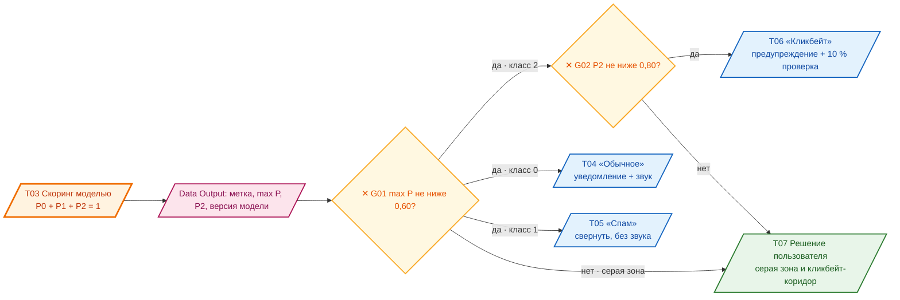
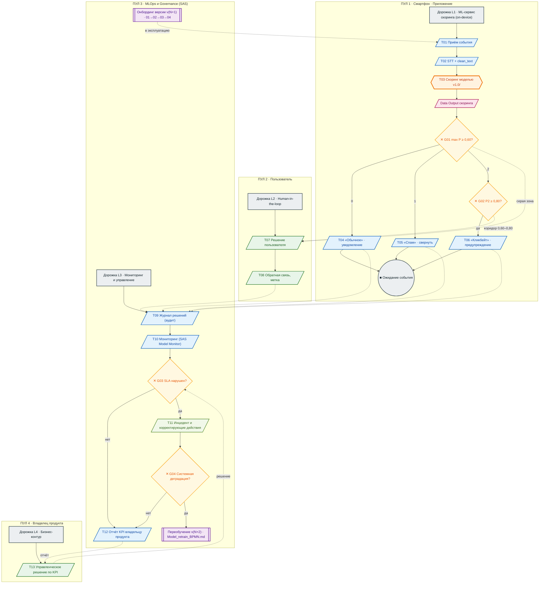

# Model_BPMN.md — BPMN 2.0: место модели в бизнес‑процессе

**Проект:** «Классификация спама и кликбейта: распознавание спам‑сообщений и кликбейт‑заголовков»

**Модель:** `spam_clickbait_classifier_ru`, версия **1.0** (champion, «Модель 2» из `model.ipynb`)

**Нотация:** **OMG BPMN 2.0.2** (Formally/2011‑01‑05), глава 10 «Flow Objects», глава 11 «Flows», глава 12 «Artifacts», глава 13 «Data»

**Связанные документы:** `model_card.md` (метрики, пороги, ограничения) · `Model_retrain_BPMN.md` (переобучение)

---

## 1. Назначение и границы диаграммы

### 1.1. Что показывает эта диаграмма

Место ML‑модели в сквозном процессе продукта **«Обработка входящих голосовых сообщений
и звонков»**: где модель стоит в потоке, что она получает на вход, что делает с
результатом, кто и когда вмешивается в её решения, как её работа контролируется
и что происходит, когда она деградирует.

### 1.2. Границы процесса (Scope)

| | Описание |
|---|---|
| **Начало** | Погружение в пул сообщений: входящий звонок или новое голосовое сообщение в мессенджере |
| **Конец** | Решение доведено до пользователя и записано в журнал; процесс возвращается в режим ожидания следующего события |
| **Включено** | приём события · распознавание речи · предобработка · **скоринг моделью** · маршрутизация решения · действия в интерфейсе · **решение пользователя (human‑in‑the‑loop)** · обратная связь · аудит · мониторинг · обработка инцидента |
| **Исключено (вне scope)** | само переобучение модели → процесс `Model_retrain_BPMN.md`; онбординг новой версии — показан **свёрнутым подпроцессом** (шаг 4.1); передача и хранение аудиозаписей — зона ответственности ОС и мессенджеров |

### 1.3. Участники (Pools) и дорожки (Lanes) — по стандарту BPMN 2.0

| Pool (Participant) | Lane | Роль в процессе |
|---|---|---|
| **P1. Смартфон · Приложение** | L1 «ML‑сервис скоринга (on‑device)» | Приём события, распознавание речи, предобработка, **скоринг моделью**, применение порогов, показ решения |
| **P2. Пользователь** | L2 «Human‑in‑the‑loop» | Окончательное решение по сомнительным сообщениям, прослушивание, обратная связь |
| **P3. MLOps · Governance (SAS)** | L3 «Мониторинг и управление» | Журнал решений, ежедневный мониторинг, инциденты, онбординг версий, запуск переобучения |
| **P4. Владелец продукта** | L4 «Бизнес‑контур» | Получение KPI, принятие управленческих решений |

---

## 2. Легенда: элементы схемы и их соответствие стандарту OMG BPMN 2.0+

| Элемент BPMN 2.0 | Раздел спецификации | Каноническая форма | Как изображено в Mermaid | Где в этой схеме |
|---|---|---|---|---|
| **Pool** (Participant) | гл. 10, *Participant* | Прямоугольник с заголовком‑дорожкой | `subgraph P…` | P1–P4 |
| **Lane** (Participant + LaneSet) | гл. 10, *Participant* | Полоса внутри пула | `subgraph` внутри `subgraph` | L1–L4 |
| **Start Event (none)** | гл. 10, *Event* / *StartEvent* | Круг | `(( … ))` | «Старт» |
| **Intermediate Event (Message Catch)** | гл. 10, *IntermediateEvent* | Круг с двойной обводкой | `(( … ))` с подписью | не используется (вход моделирован Receive Task) |
| **End Event (terminate)** | гл. 10, *EndEvent* | Круг с жирной обводкой | `(( … ))` | «Ожидание следующего события» |
| **Task** (абстрактный) | гл. 10, *Task* | Скруглённый прямоугольник | `[ … ]` | — |
| **Service Task** | гл. 10, *ServiceTask* | Прямоугольник  | `[ / … / ]` | T01, T02, **T03**, T04, T05, T06, T09, T10, T12 |
| **User Task** | гл. 10, *UserTask* | Прямоугольник  | `[ / … / ]` | T07, T08, T11 |
| **Manual Task** | гл. 10, *ManualTask* | Прямоугольник | `[ … ]` | T11 (корректирующие действия) |
| **Receive Task** | гл. 10, *ReceiveTask* | Прямоугольник (приём) | `[ / … / ]` | T01 |
| **Send Task** | гл. 10, *SendTask* | Прямоугольник (отправка) | `[ > … ]` | уведомления T04–T06 |
| **Exclusive Gateway** | гл. 10, *ExclusiveGateway* | Ромб, маркер «X» | `{ … }` с «✕» | **G01, G02, G03, G04** |
| **Sub‑Process (collapsed)** | гл. 10, *SubProcess* | Прямоугольник с «+» | `[[ … ]]` | Онбординг версии, Переобучение |
| **Data Store** | гл. 13, *DataStore* | Цилиндр | `[( … )]` | `DS_LOG`, `DS_LABELS` |
| **Data Object / Output** | гл. 13, *DataObject* | Лист с загнутой страницей | `[/ … /]` с именем переменной | `P012`, `ВЕРСИЯ` |
| **Text Annotation** | гл. 12, *Artifact* | Скобки с текстом + association | `> … ]` + пунктирная линия | правила, предупреждения |
| **Sequence Flow** | гл. 11, *SequenceFlow* | Сплошная стрелка, подпись условия | `-->` / `-->│условие│` | все переходы внутри пула |
| **Message Flow** | гл. 11, *MessageFlow* | **Пунктирная** стрелка между пулами | `-.->` | взаимодействие P1↔P2↔P3↔P4 |
| **Association (пунктирная)** | гл. 12, *Association* | Пунктирная линия без стрелки на конце логики | `-.->` к заметке | пояснения, предупреждения |

---

## 3. Схема 3.1. Основной процесс — горизонтально, слева направо

> Роль исполнителя указана в каждом блоке (курсивом в подписи — пул по §1.3).

```mermaid
flowchart LR
    classDef svc fill:#E3F2FD,stroke:#1565C0,stroke-width:2px,color:#0d47a1
    classDef mdl fill:#FFF3E0,stroke:#EF6C00,stroke-width:3px,color:#bf360c
    classDef usr fill:#E8F5E9,stroke:#2E7D32,stroke-width:2px,color:#1b5e20
    classDef man fill:#F1F8E9,stroke:#558B2F,stroke-width:2px,color:#33691E
    classDef gate fill:#FFF8E1,stroke:#F9A825,stroke-width:2px,color:#e65100
    classDef ev fill:#ECEFF1,stroke:#37474F,stroke-width:2px,color:#102027
    classDef sub fill:#F3E5F5,stroke:#6A1B9A,stroke-width:2px,color:#4A148C
    classDef dat fill:#FCE4EC,stroke:#AD1457,stroke-width:2px,color:#880e4f

    ST(("▶ Старт<br/>входящий звонок<br/>или голосовое")):::ev
    T01[/"T01 Приём события<br/>msg_id, канал, timestamp<br/>Приложение"/]:::svc
    T02[/"T02 Распознавание речи + clean_text<br/>регистр, ё→е, HTML, URL, числа→NUM<br/>Приложение"/]:::svc
    T03{{"T03 СКОРИНГ МОДЕЛЬЮ v1.0 · spam_clickbait_classifier_ru<br/>TF-IDF word 1-2 + char_wb 3-5 → LogReg C=10, balanced<br/>60 000 признаков · ~1 мс · Приложение (on-device)"}}:::mdl
    DO1[/"Скоринг: P0, P1, P2, метка, max P, версия модели"/]:::dat
    G01{"✕ G01 Порог уверенности<br/>max P не ниже 0,60 ?"}:::gate
    T04[/"T04 «Обычное»<br/>уведомление со звуком<br/>Приложение"/]:::svc
    T05[/"T05 «Спам»<br/>свернуть, без звука<br/>Приложение"/]:::svc
    G02{"✕ G02 Порог кликбейта<br/>P2 не ниже 0,80 ?"}:::gate
    T06[/"T06 «Кликбейт»<br/>предупреждение + 10 % выборка<br/>Приложение"/]:::svc
    T07[/"T07 РЕШЕНИЕ ПОЛЬЗОВАТЕЛЯ<br/>серая зона 2,64 % и кликбейт-коридор 1,76 %<br/>Пользователь"/]:::usr
    T08[/"T08 Обратная связь<br/>«спам / кликбейт / обычное»<br/>Пользователь"/]:::usr
    T09[/"T09 Журнал решений (аудит)<br/>msg_id, P0/P1/P2, решение, версия, время<br/>MLOps · SAS"/]:::svc
    T10[/"T10 Ежедневный мониторинг<br/>PSI, баланс классов, серая зона, качество по меткам<br/>MLOps · SAS Model Monitor"/]:::svc
    G03{"✕ G03 Шлюз SLA нарушен?<br/>F1w ниже 0,92 · F1 кликбейта ниже 0,85 ·<br/>ошибка на обычных выше 6 % · PSI выше 0,2"}:::gate
    T11[/"T11 Инцидент: алерт, поднять порог,<br/>откат на резервные правила<br/>MLOps + бизнес"/]:::man
    G04{"✕ G04 Системная деградация?<br/>нужно переобучение?"}:::gate
    T12[/"T12 Отчёт KPI владельцу продукта<br/>авто-решения, блоки, жалобы, время реакции<br/>MLOps · SAS"/]:::svc
    T13[/"T13 Управленческое решение<br/>пороги, политика, эскалация<br/>Владелец продукта"/]:::usr
    SPO[["ОНБОРДИНГ версии v(N+1)<br/>01 Разработка → 02 Валидация →<br/>03 Утверждение (HITL) → 04 Деплой<br/>MLOps · SAS Model Manager + Workflow Manager"]]:::sub
    SPR[["ПЕРЕОБУЧЕНИЕ → версия v(N+2)<br/>Model_retrain_BPMN.md · DS + бизнес"]]:::sub
    WAIT(("■ Ожидание следующего события")):::ev
    PROCEND(("■ Процесс переобучения завершён")):::ev
    DSL1[("DS_LOG · Журнал решений и аудит")]
    DSL2[("DS_LABELS · Метки пользователей = ground truth")]

    ST --> T01 --> T02 --> T03 --> DO1 --> G01
    G01 -->|"класс 0"| T04
    G01 -->|"класс 1"| T05
    G01 -->|"класс 2"| G02
    G02 -->|"да"| T06
    G02 -->|"нет"| T07
    G01 -->|"серая зона"| T07
    T07 --> T08
    T04 --> T09
    T05 --> T09
    T06 --> T09
    T07 --> T09
    T08 --> DSL2
    T09 --> DSL1
    DSL1 --> T10
    DSL2 --> T10
    T10 --> G03
    G03 -->|"нет"| T12
    G03 -->|"да"| T11
    T11 --> G04
    G04 -->|"нет"| T12
    G04 -->|"да"| SPR
    SPR --> PROCEND
    T12 --> WAIT
    T12 --> T13
    T13 --> G03
    SPO --> T01
```

### 3.1a. Схема 3.1. Укрупнённое правило принятия решения G01 / G02 (zoom)

| Правило | Условие | Результат | Доля потока (измерено) |
|---|---|---|---:|
| Уверенность | `max P ≥ 0,60` | решение принимается автоматически | **97,36 %** |
| Серая зона | `max P < 0,60` | решение пользователя | **2,64 %** |
| Кликбейт‑коридор | `0,60 ≤ P₂ < 0,80` | решение пользователя | **1,76 %** |
| Очень уверенно | `max P ≥ 0,80` | автоматическое, низкий риск | **91,42 %** |
| **Итого вовлечение человека** | — | — | **≈ 4,4 %** |

### 3.1b. Схема 3.2. Тот же процесс в виде пулов и дорожек (BPMN Pool / Lane)

> Каноническое представление BPMN 2.0: каждый пул — отдельный участник со своей
> границей ответственности. Вертикальная ориентация здесь выбрана сознательно:
> в swimlane‑виде дорожки читаются сверху вниз, а путь одного сообщения —
> **сверху вниз по дорожкам, затем снова наверх** к пользователю.

### 3.2. Как читать схему (для владельца процесса)

> **Слева направо — это путь одного входящего сообщения.** Цветом выделен ровно один блок — **оранжевая рамка «T03 Скоринг моделью»**. Это и есть сама ML‑модель. 
1. **Слева** телефон ловит звонок или голосовое сообщение.
2. **T02** превращает звук в текст и приводит его к тому виду, который понимает
   модель (регистр, «ё», ссылки, числа).
3. **T03** — модель. Она смотрит на текст и отвечает: «вероятность, что это обычное
   сообщение — такая‑то», и так для трёх классов. **Один вызов, около 1 мс.**
4. **G01 / G02** — правила, когда доверять модели, а когда спросить человека.
   Сейчас модель уверена на **97,4 %** входящих, поэтому человеку уходят только
   2,64 % + 1,76 % ≈ **4,4 %**.
5. **T04–T06** — система ведёт себя по‑разному: обычное — со звуком, спам — молча
   в папку, кликбейт — с предупреждением.
6. **T07–T08** — всё, в чём модель не уверена, попадает к человеку. Он слушает,
   решает сам и может сказать «модель ошиблась». **Модель никогда не решает за него.**
7. **T09–T10** — каждое решение записывается и ежедневно проверяется: не поехали ли
   данные, не начала ли модель ошибаться чаще.
8. **G03 / G04** — если качество упало ниже нормы, происходит **инцидент** (T11), и
   либо чинят настройками, либо запускают **переобучение** (фиолетовый блок справа).
9. **Обратная стрелка внизу** — процесс не заканчивается: телефон снова ждёт
   следующего сообщения, а модель — следующей проверки. Это замкнутый контур,
   а не разовая операция.
10. **Схема 3.2 (дорожки)** — тот же процесс с точки зрения «кто за что отвечает».
    Видно, что пользователь отвечает только за **решение по конкретному сообщению**,
    а MLOps — за контроль качества, и что это **разные люди с разными задачами**.

---

## 4. Спецификация элементов по стандарту OMG BPMN 2.0+

### 4.0. Онбординг новой версии модели (свёрнутый подпроцесс)

> Детали — в `model_card.md` §6.2.

| Элемент BPMN 2.0 | Содержимое подпроцесса | Исполнитель |
|---|---|---|
| **Service Task** | 01 Разработка: запуск `model.ipynb`, обучение, расчёт метрик | DS‑команда |
| **Service Task** | 02 Валидация: сверка метрик с порогами, проверка границ применимости | SAS Workflow Manager (авто) |
| **User Task** | **03 Утверждение:** форма с метриками и кнопками «Одобрить» / «Отклонить с комментарием» | Бизнес‑владелец + риск‑функция (**human‑in‑the‑loop**) |
| **Service Task** | 04 Деплой: регистрация в SAS Model Manager, экспорт артефакта в приложение, canary 5–10 % | ML‑инженер |
| **Data Store** | Паспорт модели + **Model Card** v(N+1) | SAS Model Manager |

### 4.1. Пошаговая спецификация потока

| ID | Тип BPMN 2.0 | Имя | Пул / дорожка | Исполнитель | Вход | Выход (передаётся дальше) | Правило / условие |
|---|---|---|---|---|---|---|---|
| **Start** | Start Event (none) | Входящий звонок или голосовое сообщение | P1 | ОС телефона / мессенджер | — | событие входящего аудио | Telegram, WhatsApp, VK, MAX, обычный звонок |
| **T01** | **Receive Task** | Приём события | P1 / L1 | Приложение (мост уведомлений мессенджеров) | аудиопоток | `msg_id`, `channel`, `timestamp` | SLA приёма ≤ 2 с |
| **T02** | Service Task | Распознавание речи + `clean_text` | P1 / L1 | Модуль STT + код `model.ipynb` | `msg_id`, аудио | нормализованный текст | требует чтения прав на микрофон; текст **не покидает устройство** |
| **T03** | **Service Task ** | **Скоринг моделью `spam_clickbait_classifier_ru` v1.0** | P1 / L1 | champion‑модель (ONNX/Core ML) | нормализованный текст | `P0, P1, P2`, метка `argmax`, `max P`, версия модели | Латентность p95 ≤ 200 мс (факт ≈ 1,5 мс); результат пишется в `DS_LOG` |
| **DO** | Data Object / Data Output | Результат скоринга | P1 → P2 | — | — | структурированный пакет скоринга | формат фиксирован; включает версию модели для аудита |
| **G01** | **Exclusive Gateway** | Порог уверенности | P1 / L1 | правило приложения | `max P`, метка | маршрут решения | `max P ≥ 0,60` ? **да** → по метке; **нет** → серая зона → T07. Обоснование порога: бизнес‑требование «≥ 85 % авто‑решений», фактически 97,36 % |
| **T04** | Service Task (Send) | Действие «Обычное» | P1 / L1 | Приложение | метка 0 | показано обычное уведомление + звук | риск ограничен метрикой Recall(0) = 0,9522 (ошибка 4,78 % ≤ лимита 5 %) |
| **T05** | Service Task (Send) | Действие «Спам» | P1 / L1 | Приложение | метка 1 | свернуто, без звука, в папку «Спам» | качество ограничено Precision(1) = 0,9716 → в карантин попадает 2,84 % «не спама» |
| **G02** | **Exclusive Gateway** | Порог кликбейта | P1 / L1 | правило приложения | `P₂`, `max P` | маршрут решения | `P₂ ≥ 0,80` ? **да** → T06; **нет** (0,60 ≤ P₂ < 0,80) → T07. Публикация кликбейта несёт репутационный риск → обязательное решение человека |
| **T06** | Service Task (Send) | Действие «Кликбейт» | P1 / L1 | Приложение | метка 2, `P₂ ≥ 0,80` | показ с предупреждением + **выборочная проверка 10 %** | Recall(2) = 0,9001, Precision(2) = 0,8652; остаток компенсируется коридором 0,60–0,80 |
| **T07** | **User Task** | **Решение пользователя** (серая зона / кликбейт‑коридор) | P2 / L2 | Пользователь | результат скоринга с пометкой «не уверен» | итоговое решение: открыть / прослушать / отклонить | **обязательный human‑in‑the‑loop**; совокупная нагрузка ≈ 4,4 % входящих |
| **T08** | **User Task** | Обратная связь (разметка) | P2 / L2 | Пользователь | решение T07 или T04–T06 | метка пользователя → `DS_LABELS` | добровольно; ≥ 200 меток в неделю = контрольная выборка мониторинга |
| **T09** | Service Task | Журналирование (аудит) | P3 / L3 | SAS | все решения | запись в `DS_LOG` | Governance «полный аудит»: решение, вероятности, версия, время, канал |
| **T10** | Service Task | Ежедневный мониторинг | P3 / L3 | SAS Model Monitor | `DS_LOG`, `DS_LABELS` | метрики мониторинга | PSI ≤ 0,2; доля серой зоны ≤ 15 % (факт 2,64 %); качество по контрольной выборке |
| **G03** | **Exclusive Gateway** | Шлюз SLA нарушен? | P3 / L3 | правило мониторинга | метрики | маршрут инцидента | `F1w < 0,92` **ИЛИ** `F1(кликбейт) < 0,85` **ИЛИ** ошибка на обычных > 6 % **ИЛИ** `PSI > 0,2`. Пороги «пола» — `model_card.md` §5.3 |
| **T11** | **Manual Task** + User Task | Инцидент: корректирующие действия | P3 / L3 | MLOps + бизнес | факт нарушения | временное ужесточение порогов / откат на резервные правила | обратимо; ограничивает радиус инцидента без остановки продукта |
| **G04** | **Exclusive Gateway** | Системная деградация? | P3 / L3 | MLOps + бизнес | результат T11 | маршрут переобучения | «да» (стойкая деградация, дрейф потока) → запуск `Model_retrain_BPMN.md`; «нет» → наблюдение |
| **T12** | Service Task (Send) | Отчёт владельцу продукта | P3 / L3 | SAS → BI | метрики, KPI | еженедельный отчёт KPI | еженедельно; в период инцидента — ежедневно |
| **T13** | **User Task** | Управленческое решение по KPI | P4 / L4 | Владелец продукта | отчёт T12 | изменение порогов/политик либо подтверждение текущих настроек | закрывает контур «бизнес ↔ модель» |
| **SP_RETRAIN** | Sub‑Process (collapsed) | Переобучение `v(N+2)` | P3 / L3 | DS‑команда + бизнес | сигнал G04 | новая версия модели | полный цикл — `Model_retrain_BPMN.md` |
| **End** | End Event (terminate) | Процесс завершён | P3 | — | результат переобучения | новая версия v(N+2) готова к онбордингу | возврат в операционный цикл |

### 4.2. Потоки (Flows — гл. 11 стандарта BPMN 2.0)

| Тип потока | Откуда → Куда | Условие / наименование |
|---|---|---|
| Sequence Flow | Start → T01 | «аудиособытие получено» |
| Sequence Flow | T02 → T03 | «текст нормализован» |
| Sequence Flow | T03 → DO → G01 | «результат скоринга» |
| Sequence Flow | G01 → T04 | «класс 0» |
| Sequence Flow | G01 → T05 | «класс 1» |
| Sequence Flow | G01 → G02 | «класс 2» |
| Sequence Flow | G01 → T07 | «серая зона: max P < 0,60» |
| Sequence Flow | G02 → T06 | «да: P₂ ≥ 0,80» |
| Sequence Flow | G02 → T07 | «нет: 0,60 ≤ P₂ < 0,80» |
| Sequence Flow | T04/T05/T06 → End | «решение исполнено автоматически» |
| **Message Flow** | T03 → T07 (P1→P2) | «запрос решения человеку» — *прерывает* пул |
| Sequence Flow | T07 → T08 | «решение принято» |
| **Message Flow** | T04/T05/T06/T07 → T09 (P1/P2→P3) | «запись аудита» — *прерывает* пул |
| **Message Flow** | T08 → T09 (P2→P3) | «новая метка пользователя» |
| **Message Flow** | T09 → T10 (внутри P3) | «данные для мониторинга» |
| Sequence Flow | T10 → G03 | «метрики рассчитаны» |
| Sequence Flow | G03 → T12 | «нет: SLA соблюдён» |
| Sequence Flow | G03 → T11 → G04 | «да: SLA нарушен» |
| Sequence Flow | G04 → T12 | «нет: локальная проблема» |
| Sequence Flow | G04 → SP_RETRAIN | «да: системная деградация» |
| **Message Flow** | T12 → T13 (P3→P4) | «отчёт KPI» — *прерывает* пул |
| **Message Flow** | T13 → G03 (P4→P3) | «управленческое решение» — замыкает контур |

### 4.3. Данные (Data — гл. 13 стандарта BPMN 2.0)

| ID | Тип BPMN 2.0 | Имя | Поля | Назначение |
|---|---|---|---|---|
| **DO_SCORING** | Data Output | Результат скоринга | `p0`, `p1`, `p2`, `label`, `max_p`, `model_version`, `ts` | передаётся из T03 в правила G01/G02 и в журнал |
| **DS_LOG** | **Data Store** | Журнал решений и аудит | `msg_id`, `channel`, `raw_text_hash`, `p0/p1/p2`, `label`, `decision_source` (auto\|user), `model_version`, `ts` | полный аудит; база расчёта мониторинга и разбора жалоб |
| **DS_LABELS** | **Data Store** | Метки пользователей (ground truth) | `msg_id`, `user_label`, `ts`, `model_label`, `agreed` | контрольная выборка для F1‑мониторинга и обучающая выборка следующего переобучения |
| **DS_REF** | Data Store Reference | Справочник версий моделей | `version`, `changelog`, `approved_by`, `approved_at` | аудит: какая версия решала и кто её утверждал |

### 4.4. Annotations (Artifacts — гл. 12 стандарта BPMN 2.0)

| # | Текст заметки | Связана с |
|---|---|---|
| A1 | **Доменный разрыв:** модель обучена на печатном тексте, продукт работает с STT‑транскриптами. Метрики на целевом домене **не измерены** (`model_card.md` §5.6) | T02, T03 |
| A2 | **Ключевой шаг модели.** Единственное место в процессе, где принимается ML‑решение | T03 |
| A3 | **Приватность:** инференс локальный; текст не передаётся на сервер | T02, T03 |
| A4 | **Human‑in‑the‑loop:** модель не имеет права единолично скрыть обычное сообщение | T07 |
| A5 | **Audit:** каждое решение логируется с версией модели | T09 |
| A6 | **Пороги 0,60 / 0,80 заданы экспертно и не калиброваны** — при переобучении обязательна проверка reliability‑кривых | G01, G02 |
| A7 | **Порог‑«пол» SLA:** F1w 0,92 · F1(кликбейт) 0,85 · ошибка на обычных 6 % · PSI 0,2 | G03 |
| A8 | **Замкнутый цикл:** мониторинг → триггер → переобучение → новая версия → мониторинг | G04, SP_RETRAIN |

### 4.5. Проверка соответствия стандарту OMG BPMN 2.0 (чеклист)

| Требование стандарта | Выполнено | Где |
|---|---|---|
| Процесс имеет Start Event и End Event | + | §4.1 |
| Все шаги имеют однозначный тип из каталога Flow Objects (Task / Service / User / Manual / Send / Receive / SubProcess) | + | §4.1 |
| У каждого Exclusive Gateway заданы исходящие потоки с **условиями**, покрывающие все случаи, и **ровно один** поток по умолчанию | + | §4.2 |
| Логическое разделение выполняется **шлюзами**, а не условиями внутри задач | + | G01–G04 |
| Параллельность выражена **Parallel Gateway**, а не неявно | + | параллельных ветвей нет — сделано намеренно (см. §4.6) |
| Межпуловые взаимодействия оформлены **Message Flow** (пунктирными), а не Sequence Flow | + | §4.2 |
| Данные оформлены элементами **Data Object / Data Store**, а не текстом в названии задачи | + | §4.3 |
| Пояснения оформлены **Text Annotation + Association**, а не комментариями | + | §4.4 |
| Каждый пул имеет назначенного исполнителя (роль) | + | §1.3 |
| Циклы моделируются **обратным потоком**, а не повторным объявлением процесса | + | §4.6 |
| Элементы имеют смысловые имена на русском языке (для владельца процесса) | + | §4.1 |
| Машиночитаемый экспорт по стандарту (BPMN 2.0 XML + DI) | + | Приложение Б |

### 4.6. Сознательные проектные решения

| Решение | Обоснование |
|---|---|
| **Parallel Gateway не используется** | Все шаги линейны и быстры; параллельный запуск усложнил бы интерфейс без выигрыша. Если понадобится одновременно вести аудит и отправку телеметрии — добавляется Parallel Gateway с двумя ветвями и Join |
| **Цикл моделируется одним «долгоживущим» экземпляром** | Сообщения идут непрерывным потоком; стандартный подход «один экземпляр = одно сообщение» создал бы миллионы экземпляров. Реализация: **event‑based receive** на T01 + фоновый таймер мониторинга |
| **G03 объединяет четыре условия в один шлюз** | Для владельца процесса это один вопрос: «норма в норме или нет?» Разбивка по причинам остаётся в тексте инцидента T11 |
| **Онбординг версии показан свёрнутым подпроцессом** | Он происходит раз в 6 месяцев, а не на каждом сообщении; развёрнутая версия перегрузила бы основную схему (модульность подпроцессов) |

---

## 5. Согласованность с `model_card.md`

| Элемент схемы | Значение из Model Card | Реализация |
|---|---|---|
| T02 — предобработка | §2.4, 8 шагов `clean_text` | + |
| T03 — архитектура | §0: `FeatureUnion` word 1‑2 + char_wb 3‑5, `LogReg C=10`, 60 000 признаков | + |
| G01 — порог 0,60 | §4.4 (обоснование: 97,36 % авто‑решений) | + |
| G02 — порог 0,80 | §4.4, §5.1 | + |
| Нагрузка на человека | §4.4: серая зона 2,64 % + кликбейт‑коридор 1,76 % ≈ **4,4 %** | + |
| Recall(0) = 0,9522 у T04 | §4.2, §4.5 | + |
| Precision(1) = 0,9716 у T05 | §4.2, §4.3 | + |
| Recall(2) / Precision(2) у T06 | §4.2 | + |
| G03 — пороги «пол» | §5.3: 0,92 / 0,85 / 6 % / PSI 0,2 | + |
| Доменный разрыв (заметка A1) | §5.6 | + |
| Отсутствие калибровки (заметка A6) | §5.5, п. 5 | + |
| Латентность ≤ 200 мс у T03 | §6.6: факт ≈ 1,15 мс | + |

**Противоречий не выявлено.**

---

## Приложение А. Файлы с исходниками диаграмм (Mermaid)

| Файл | Схема |
|---|---|
| `bpmn_operation_v2.mmd` | §3.1 — основной процесс (горизонтально) |
| `bpmn_operation_zoom.mmd` | §3.1a — zoom правила G01 / G02 |
| `bpmn_operation_lanes.mmd` | §3.1b — пулы и дорожки |
| `mc_flow.mmd` | горизонтальная схема из `model_card.md` §6.1 |
| `mc_sas_integration.mmd` | схема интеграции SAS из `model_card.md` §6.2 |

Каждый файл содержит **тот же** код Mermaid, что и соответствующий блок
`mermaid` в документах, и рендерится в GitHub / GitLab / VS Code / Typora / mermaid‑cli.

---

