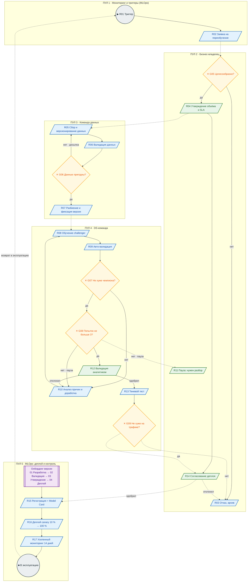

# Model_retrain_BPMN.md — BPMN 2.0: процесс автоматического переобучения модели

**Проект:** «Классификация спама и кликбейта: распознавание спам‑сообщений и кликбейт‑заголовков»

**Модель:** `spam_clickbait_classifier_ru` · переход **v(N) → v(N+1)**

**Нотация:** **OMG BPMN 2.0.2** (гл. 10 Flow Objects · гл. 11 Flows · гл. 12 Artifacts · гл. 13 Data)

**Точка входа:** шлюз **G04** BPMN эксплуатации (`Model_BPMN.md`) либо собственные триггеры (R01)

**Точка выхода:** новая версия **v(N+1)** зарегистрирована, задеплоена и возвращена в штатную эксплуатацию (`Model_BPMN.md`)

**Связанные документы:** `model_card.md` (метрики‑эталоны и пороги) · `Model_BPMN.md` (текущая эксплуатация)

---

## 1. Назначение диаграммы

Диаграмма отвечает на три вопроса:

1. **Что запускает переобучение** — перечень триггеров и правило их срабатывания (R01).
2. **Какие проверки проходит новая модель** — четыре уровня контроля: данные (G06) →
   метрики (G07) → защита от бесконечного цикла (G08) → живой трафик (G09).
3. **При каких условиях новая версия попадает в эксплуатацию** — правило
   «не хуже чемпиона» плюс два обязательных согласования человеком (R12, R14).

Дополнительно показаны **действия при неуспешном прохождении проверок** — ветви,
которые обычно и определяют, сможет ли команда поддерживать модель вообще.

---

## 2. Легенда соответствия стандарту OMG BPMN 2.0+

| Элемент BPMN 2.0 | Раздел спецификации | Как изображено в Mermaid | Где в этой схеме |
|---|---|---|---|
| **Pool / Lane** | гл. 10, *Participant* | `subgraph` | P1 «Мониторинг и триггеры», P2 «Бизнес‑владелец», P3 «Команда данных», P4 «DS‑команда», P5 «MLOps: деплой и контроль» |
| **Start Event (timer / message)** | гл. 10, *StartEvent* | `(( … ))` | R01 — семь видов триггеров (см. §5) |
| **End Event (terminate)** | гл. 10, *EndEvent* | `(( … ))` | END1 (отказ), END2 (в эксплуатацию), END3 (пауза цикла) |
| **Service Task** | гл. 10, *ServiceTask* | `[ / … / ]`| R02, R03, R05, R06, R07, R08, R09, R10, R13, R15, R16, R17 |
| **User Task** | гл. 10, *UserTask* | `[ / … / ]`| R04, R11, R12, R14 |
| **Send Task** | гл. 10, *SendTask* | `[ … ]` | уведомления Teams / Telegram / email |
| **Exclusive Gateway** | гл. 10, *ExclusiveGateway* | `{ … }` с ✕ | **G05, G06, G07, G08, G09** |
| **Sub‑Process (collapsed)** | гл. 10, *SubProcess* | `[[ … ]]` | Онбординг версии (01→02→03→04) |
| **Data Store** | гл. 13, *DataStore* | `[( … )]` | `DS_DATA`, `DS_METRICS`, `DS_REGISTRY`, `DS_LABELS` |
| **Text Annotation** | гл. 12, *Artifact* | заметка + пунктирная ассоциация | A1–A8 |
| **Sequence Flow** | гл. 11, *SequenceFlow* | `-->` с условием | внутри пула |
| **Message Flow** | гл. 11, *MessageFlow* | `-.->` | между пулами |

> Каноническая геометрия BPMN задана в машинночитаемом файле `bpmn_retrain.bpmn` (Приложение Б),
> который открывается в bpmn.io / Camunda Modeler / Flowable / SAS Workflow Manager.

---

## 3. Схема 3.1. Процесс переобучения — от триггера до новой версии в проде

```mermaid
flowchart LR
    classDef svc fill:#E3F2FD,stroke:#1565C0,stroke-width:2px,color:#0d47a1
    classDef mdl fill:#FFF3E0,stroke:#EF6C00,stroke-width:3px,color:#bf360c
    classDef usr fill:#E8F5E9,stroke:#2E7D32,stroke-width:2px,color:#1b5e20
    classDef gate fill:#FFF8E1,stroke:#F9A825,stroke-width:2px,color:#e65100
    classDef ev fill:#ECEFF1,stroke:#37474F,stroke-width:2px,color:#102027
    classDef sub fill:#F3E5F5,stroke:#6A1B9A,stroke-width:2px,color:#4A148C
    classDef dat fill:#FCE4EC,stroke:#AD1457,stroke-width:2px,color:#880e4f

    R01(("▶ R01 ТРИГГЕР<br/>G04 из эксплуатации · падение SLA<br/>PSI выше 0,2 · 10 000 меток<br/>плановый цикл 6 мес<br/>новый тип спама<br/>доменный разрыв: набор транскриптов")):::ev
    R02[/"R02 Заявка на переобучение<br/>метрики деградации, гипотеза причины,<br/>ожидаемый эффект, нуный объём данных<br/>уведомление владельцу (Teams / email)"/]:::svc
    G05{"✕ G05 Целесообразно<br/>переобучение?<br/>эффект выше затрат,<br/>риск приемлем"}:::gate
    R03[/"R03 Отклонить заявку,<br/>архивировать с причиной<br/>уведомление автору заявки"/]:::svc
    END1(("■ Процесс завершён:<br/>модель не меняется")):::ev
    R04[/"R04 Утверждение объёма, сроков<br/>и SLA новой версии<br/>БИЗНЕС‑ВЛАДЕЛЕЦ · SLA 24 ч"/]:::usr
    R05[/"R05 Сбор и версионирование данных<br/>df.csv v(N+1) = df.csv v1 + метки пользователей<br/>+ транскрипты голосовых + свежая разметка<br/>в Git, новая версия датасета"/]:::svc
    R06[/"R06 Валидация данных<br/>дубликаты · баланс классов · пустые после очистки<br/>двойная выборочная разметка (шум меток)<br/>проверка наличия даты и канала"/]:::svc
    G06{"✕ G06 Данные пригодны?<br/>объём, баланс,<br/>качество меток"}:::gate
    R07[/"R07 Разбиение и фиксация версии<br/>train/test 80/20, stratify, seed 42<br/>+ временной разрез · версия в Git"/]:::svc
    R08[/"R08 Обучение challenger<br/>clean_text → TF-IDF word 1-2 + char_wb 3-5<br/>→ LogReg, GridSearch C по f1_weighted,<br/>StratifiedKFold 3 + калибровка вероятностей"/]:::svc
    R09[/"R09 Авто-валидация на отложенном Test<br/>метрики по классам, ROC-AUC, матрица ошибок,<br/>доля авто-решений при порогах 0,60 / 0,80<br/>артефакты → MLflow / Neptune / SAS Model Manager"/]:::svc
    G07{"✕ G07 QUALITY GATES<br/>аукцион challenger vs champion<br/>F1w не ниже 0,9455 · F1 кликбейта не ниже 0,8823<br/>Recall обычных не ниже 0,9522 · Recall спама не ниже 0,9632<br/>авто-решений не ниже 85 %"}:::gate
    R10[/"R10 Анализ причин и доработка<br/>фичи, баланс, разметка, пороги,<br/>гипотеза причины деградации"/]:::svc
    G08{"✕ G08 Калитровочный шлюз<br/>попыток подряд не больше 3?"}:::gate
    R11[/"R11 ПАУЗА ЦИКЛА<br/>«Требуется анализ причины дрейфа»<br/>уведомление владельцу и DS‑лиду<br/>приостановка автоматических запусков"/]:::usr
    END3(("■ Цикл приостановлен:<br/>нужен разбор, а не новая итерация")):::ev
    R12[/"R12 Валидация аналитиком<br/>форма: описание модели, метрики, шлюзы<br/>кнопки «Одобрить» / «Отклонить с комментарием»<br/>роль model_validator · SLA 24 ч"/]:::usr
    R13[/"R13 Теневой (shadow) тест 1–2 недели<br/>challenger считает параллельно с чемпионом<br/>на живом трафике, решения НЕ применяются<br/>сравнение: доля расхождений, качество по меткам"/]:::svc
    G09{"✕ G09 На живом трафике challenger<br/>не хуже чемпиона<br/>и SLA бизнеса соблюдены?"}:::gate
    R14[/"R14 Согласование деплоя<br/>бизнес‑владелец + риск‑функция<br/>подписи, решение, комментарий · SLA 24 ч"/]:::usr
    R15[/"R15 Регистрация версии v(N+1)<br/>SAS Model Manager: паспорт + ОБНОВЛЁННАЯ MODEL CARD<br/>артефакт, хэш кода, метрики, кто согласовал"/]:::svc
    R16[/"R16 ДЕПЛОЙ<br/>canary 10 % трафика → 100 %<br/>экспорт артефакта в приложение<br/>уведомление «Модель v(N+1) в продакшене»"/]:::svc
    R17[/"R17 Усиленный мониторинг 14 дней<br/>ежедневные отчёты вместо недельных,<br/>жёсткие пороги, готовность к откату"/]:::svc
    END2(("■ Модель v(N+1) в эксплуатации<br/>возврат в BPMN «Эксплуатация»")):::ev

    DSD[("DS_DATA · df.csv v(N+1), версия в Git")]
    DSM[("DS_METRICS · метрики challenger и champion")]
    DSR[("DS_REGISTRY · реестр версий SAS Model Manager")]
    DSL[("DS_LABELS · метки пользователей = ground truth")]

    R01 --> R02 --> G05
    G05 -->|"нет"| R03 --> END1
    G05 -->|"да"| R04 --> R05 --> R06 --> G06
    G06 -->|"нет · досылка"| R05
    G06 -->|"да"| R07 --> R08 --> R09 --> G07
    G07 -->|"нет · не не хуже чемпиона"| R10 --> R08
    R10 --> G08
    G07 -->|"да"| G08
    G08 -->|"попыток больше 3"| R11 --> END3
    G08 -->|"попыток не больше 3"| R12
    R12 -->|"отклонил"| R10
    R12 -->|"одобрил"| R13 --> G09
    G09 -->|"нет"| R03
    G09 -->|"да"| R14
    R14 -->|"отклонил"| R03
    R14 -->|"одобрил"| R15 --> R16 --> R17 --> END2
    R05 --> DSD
    DSD --> R07
    R06 --> DSL
    R09 --> DSM
    DSM --> G07
    R15 --> DSR
```

### 3.1a. Схема 3.2. Quality gates G06 → G07 → G08 → G09 (zoom)

```mermaid
flowchart LR
    classDef svc fill:#E3F2FD,stroke:#1565C0,stroke-width:2px,color:#0d47a1
    classDef gate fill:#FFF8E1,stroke:#F9A825,stroke-width:2px,color:#e65100
    classDef usr fill:#E8F5E9,stroke:#2E7D32,stroke-width:2px,color:#1b5e20
    classDef fail fill:#FFEBEE,stroke:#C62828,stroke-width:2px,color:#b71c1c
    classDef ok fill:#E8F5E9,stroke:#2E7D32,stroke-width:2px,color:#1b5e20

    R06[/"R06 Валидация данных"/]:::svc
    G6{"✕ G06 Данные пригодны?"}:::gate
    R05[/"R05 Досылка данных"/]:::svc
    R09[/"R09 Авто-валидация challenger"/]:::svc
    G7{"✕ G07 Не хуже чемпиона?"}:::gate
    G8{"✕ G08 Попыток не больше 3?"}:::gate
    R12[/"R12 Валидация аналитиком"/]:::usr
    G9{"✕ G09 Не хуже на живом трафике?"}:::gate
    R14[/"R14 Согласование бизнеса и риска"/]:::usr
    R15[/"R15 Регистрация и деплой"/]:::svc
    STOP1[/"■ Отказ: заявка архивируется"/]:::fail
    STOP2[/"■ Пауза цикла: нужен разбор причины"/]:::fail
    BACK[/"R10 Анализ причин и доработка"/]:::svc
    OKV[/"Версия v(N+1) разрешена к публикации"/]:::ok

    R06 --> G6
    G6 -->|"нет"| R05 --> R06
    G6 -->|"да"| R09 --> G7
    G7 -->|"нет"| BACK --> G8
    G7 -->|"да"| G8
    G8 -->|"нет · попыток больше 3"| STOP2
    G8 -->|"да"| R12
    R12 -->|"отклонил"| BACK
    R12 -->|"одобрил"| G9
    G9 -->|"нет"| STOP1
    G9 -->|"да"| R14
    R14 -->|"отклонил"| STOP1
    R14 -->|"одобрил"| R15 --> OKV
```

### 3.1b. Схема 3.3. Тот же процесс в виде пулов и дорожек

---

## 4. Основные этапы: что происходит и что передаётся дальше

### Этап 1. Триггер и согласование

| Шаг | Тип BPMN | Что происходит | Кто делает | **Результат, передаваемый на следующий шаг** |
|---|---|---|---|---|
| **R01** | Start Event (timer / message) | Срабатывает один из семи триггеров (см. §5) | SAS Model Monitor / планировщик / ручное создание | `{trigger_type, дата, ссылка на метрики}` |
| **R02** | Service Task | Формируется заявка: какие метрики просели, гипотеза причины, ожидаемый эффект, сколько данных нужно. Отправляется уведомление владельцу в Teams / email | SAS Workflow Manager (по шаблону) | **Заявка на переобучение** (документ) + уведомление |
| **G05** | Exclusive Gateway ✕ | Владелец решает: эффект переобучения выше затрат? | Владелец продукта | маршрут: «да» → R04, «нет» → R03 |
| **R03** | Service Task | Заявка отклоняется **с записанной причиной**; уведомление автору. Отказ — не «тихий», а часть аудита | Система | **Архив заявки** → END1 |
| **R04** | **User Task** | Согласование объёма данных, сроков и **SLA новой версии** | Владелец продукта | Утверждённый план: объём, срок, SLA, критерии приёмки |

### Этап 2. Данные

| Шаг | Тип BPMN | Что происходит | Кто делает | **Результат, передаваемый дальше** |
|---|---|---|---|---|
| **R05** | Service Task | Собирается новая версия набора данных: `df.csv v(N+1)` = `df.csv v1` + метки пользователей (`DS_LABELS`) + **транскрипты реальных голосовых сообщений** + свежая разметка. Версия и хэш фиксируются в Git | Команда данных | **Датасет `df.csv v(N+1)`** в `DS_DATA` |
| **R06** | Service Task | Проверки качества: полные дубликаты (в v1 их было 26,4 %), баланс классов (после дедупликации 60,4 / 21,7 / 17,9 %), **удаление пустых записей после очистки** (в v1 их было 4), **двойная выборочная разметка** 500 сообщений для оценки шума меток, наличие даты и канала | Команда данных + разметчики | **Отчёт о качестве данных** + исправленный датасет |
| **G06** | Exclusive Gateway ✕ | Данные пригодны для обучения? | Правило процесса | «да» → R07; «нет» → досылка → R05 |
| **R07** | Service Task | Разбиение 80/20 со стратификацией и `seed=42`; **дополнительно — временной разрез**, чтобы оценить устойчивость к дрейфу; версия датасета фиксируется в Git | Команда данных | **Обучающая и отложенная выборки** (train / test) |

### Этап 3. Обучение новой версии

| Шаг | Тип BPMN | Что происходит | Кто делает | **Результат, передаваемый дальше** |
|---|---|---|---|---|
| **R08** | Service Task | Обучение **challenger**: тот же пайплайн, что у чемпиона — `clean_text` → `FeatureUnion` (TF‑IDF word 1–2‑gram, 30 000 + `char_wb` 3–5‑gram, 30 000) → `LogisticRegression(class_weight='balanced')`; подбор `C` сеткой по `f1_weighted` (`StratifiedKFold(3)`). **Дополнительно:** калибровка вероятностей (`CalibratedClassifierCV`) и построение reliability‑кривых для проверки порогов 0,60 / 0,80 | DS‑команда | **Артефакт модели challenger v(N+1)** + лог обучения |
| **R09** | Service Task | Полная авто-валидация на отложенной выборке: метрики по классам, ROC‑AUC (OvR), матрица ошибок, доля авто-решений при порогах, доля серой зоны. Артефакты, параметры и метрики пишутся в MLflow / Neptune / SAS Model Manager | Система | **Отчёт по метрикам challenger** в `DS_METRICS` |

### Этап 4. Проверка качества и решение о публикации

| Шаг | Тип BPMN | Что происходит | Кто делает | **Результат** |
|---|---|---|---|---|
| **G07** | **Exclusive Gateway ✕** | **Аукцион метрик «challenger против champion».** Правило: challenger обязан быть **не хуже** по всем обязательным метрикам (таблица §6) | Система | «да» → G08; «нет» → R10 |
| **R10** | Service Task | Разбор причин: фичи, баланс, качество разметки, пороги; формулируется новая гипотеза; дорабатывается пайплайн → возврат к R08 | DS‑команда | **Новая версия пайплайна** |
| **G08** | Exclusive Gateway ✕ | **Калитровочный шлюз:** попыток обучения подряд не больше **3**. Если больше — цикл останавливается (рекомендация слайда 17 презентации) | Система | «да» → R12; «нет» → R11 |
| **R11** | **User Task** | Пауза автоматических запусков, уведомление владельца и DS‑лида, задача «Требуется анализ причины дрейфа». Цикл не крутится вхолостую | Владелец + DS‑лид | **Приостановка цикла** → END3 |
| **R12** | **User Task** | Валидация аналитиком: система генерирует форму с описанием модели, метриками (AUC, F1, дрейф) и кнопками «Одобрить» / «Отклонить с комментарием»; назначается по роли `model_validator` | Аналитик / риск‑офицер | «одобрил» → R13; «отклонил» → R10 |
| **R13** | Service Task | **Теневой (shadow) тест 1–2 недели:** challenger считает параллельно с чемпионом на живом трафике, но **решения не применяются**. Сравниваются доля расхождений и качество по меткам пользователей | Система | **Протокол shadow‑сравнения** |
| **G09** | Exclusive Gateway ✕ | На живом трафике challenger не хуже чемпиона и SLA бизнеса соблюдены? | Система + бизнес | «да» → R14; «нет» → R03 |
| **R14** | **User Task** | Согласование деплоя: подписи бизнес‑владельца и риск‑функции (SLA ≤ 24 ч) | Бизнес + комплаенс | «одобрил» → R15; «отклонил» → R03 |

### Этап 5. Регистрация, деплой, возврат в эксплуатацию

| Шаг | Тип BPMN | Что происходит | Кто делает | **Результат** |
|---|---|---|---|---|
| **R15** | Service Task | **Регистрация версии v(N+1)** в SAS Model Manager: паспорт модели, метрики, артефакт, хэш кода, кто и когда согласовал, **обновлённая Model Card** (разделы 3, 4, 6, 8). Новая версия без карты не регистрируется | ML‑инженер | **v(N+1) в реестре** `DS_REGISTRY` + утверждённая Model Card |
| **R16** | Service Task | **Деплой:** canary 10 % трафика →наблюдение → 100 %; экспорт артефакта в мобильное приложение (ONNX / Core ML); уведомление «Модель v(N+1) в продакшене» в Teams / Telegram | ML‑инженер / MLOps | **Новая версия обслуживает пользователей** |
| **R17** | Service Task | **Усиленный мониторинг 14 дней:** ежедневные отчёты вместо недельных, ужесточённые пороги, готовость к откату. После 14 дней процесс возвращается в штатный режим | MLOps | **Возврат в `Model_BPMN.md`** (эксплуатация) |
| **END2** | End Event | Новая версия в эксплуатации | — | цикл замкнут: мониторинг → триггер → переобучение → … |

---

## 5. Триггеры запуска (детализация R01)

| № | Триггер | Источник | Порог / условие | Тип |
|---|---|---|---|---|
| 1 | Системная деградация | Шлюз **G04** BPMN эксплуатации (`Model_BPMN.md`) | стойкое падение качества или дрейф потока | message |
| 2 | **Data Drift** | SAS Model Monitor | **PSI > 0,2** (в презентации как пример — `IF PSI > 0.25 THEN retrain`; здесь принят более строгий порог‑«пол» из Model Card) | timer / condition |
| 3 | **Concept Drift / Accuracy Decay** | Мониторинг качества по меткам пользователей | **F1w < 0,92** или **F1(кликбейт) < 0,85** или ошибка на обычных > 6 % | condition |
| 4 | Накопление свежей разметки | `DS_LABELS` | **≥ 10 000** новых меток пользователей | condition |
| 5 | Плановый цикл | Планировщик | каждые **6 месяцев** | timer |
| 6 | Изменение бизнеса | Бизнес‑владелец | новый тип спама / кликбейта, изменение политики модерации, изменение законодательства | message |
| 7 | **Закрытие доменного разрыва** | Продуктовая программа | накоплено **≥ 5 000 размеченных транскриптов реальных голосовых сообщений** | condition |

> Триггеры 1–3 — **автоматические**. Триггеры 4–7 — по решению человека или планировщику.
> Все пороги‑«пол» взяты из `model_card.md` §5.3, поэтому **Model Card и этот BPMN
> не могут разойтись**: изменение SLA требует синхронной правки обоих документов.

---

## 6. Quality gates: что именно проверяет новая модель

### 6.1. G06 — пригодность данных

| Проверка | Условие «пригодно» | Что будет, если нет |
|---|---|---|
| Объём | ≥ 10 000 сообщений, ≥ 1 500 в минорном классе (пропорция ≥ 10 %) | досылка (возврат R05) |
| Баланс | доля класса 2 ≥ 12 % (иначе падает Recall кликбейта) | досылка или переразвесовка |
| Дубликаты | доля полных дубликатов ≤ 5 % (в v1 было 26,4 %) | очистка и повторная проверка |
| Пустые после очистки | 0 записей (в v1 было 4) | удалить |
| Шум меток | согласованность двойной разметки ≥ 0,85 (Cohen's κ) | переразметка спорных классов |
| Наличие даты и канала | присутствуют в 100 % записей | приостановить до выгрузки |

### 6.2. G07 — аукцион метрик: challenger против champion

> Правило: **новую версию можно публиковать, только если она не хуже текущей
> ни по одному обязательному показателю.** Значения порогов — метрики champion v1.0
> на отложенной выборке (`model_card.md` §4).

| Показатель | Порог для challenger | Метрика champion v1.0 | Зачем этот порог |
|---|---:|---:|---|
| **F1‑weighted** | **≥ 0,9455** | 0,9455 | общая точность потока |
| **F1 (кликбейт)** | **≥ 0,8823** | 0,8823 | самый слабый класс — нельзя ухудшать |
| **Recall (обычные)** | **≥ 0,9522** | 0,9522 | риск потерять личное сообщение |
| **Recall (спам)** | **≥ 0,9632** | 0,9632 | защита пользователя от мошенничества |
| **Precision (спам)** | ≥ 0,9716 | 0,9716 | нельзя чаще скрывать легальные сообщения |
| ROC‑AUC (OvR weighted) | ≥ 0,9892 | 0,9892 | качество ранжирования вероятностей |
| Доля авто‑решений при 0,60 | ≥ 85 % | 97,36 % | выполнение бизнес‑требования по автоматизации |
| Доля серой зоны | ≤ 15 % | 2,64 % | нагрузка на пользователя |
| Размер и латентность | ≤ 5 МБ, p95 ≤ 200 мс | 3,82 МБ, ≈ 1,5 мс | ограничения мобильного приложения |

**Аукцион по AUC** реализован именно здесь:
если challenger показывает лучший ROC‑AUC, но худший F1 кликбейта — **он
не проходит**, потому что бизнес‑критичен именно кликбейт, а не общий AUC.
Дополнительно отслеживается **AUC на подгруппах по каналам** (Telegram / WhatsApp /
звонок): падение AUC более чем на 0,02 на любом канале = провал гейта.

### 6.3. G08 — защита от бесконечного цикла

| Счётчик попыток | Состояние | Действие |
|---|---|---|
| 1 | первая попытка | обычный цикл R08 → R09 → G07 |
| 2 | вторая попытка | обязателен комментарий в лог: **что изменилось** |
| 3 | третья попытка | допустима только с новой гипотезой, зафиксированной в R10 |
| **> 3** | лимит исчерпан | **автоматический переход на R11 (пауза)**, уведомление владельцу и DS‑лиду |

### 6.4. G09 — проверка на живом трафике (shadow)

| Проверка | Условие |
|---|---|
| Доля расхождений champion / challenger | не выше согласованного в R04 порога (ориентир ≤ 15 %) |
| Качество challenger по меткам пользователей | не ниже champion по F1w и F1 кликбейта |
| Бизнес‑SLA в shadow‑режиме | доля серой зоны ≤ 15 %, доля авто‑решений ≥ 85 % |
| Техническое | latency p95 ≤ 200 мс, размер артефакта ≤ 5 МБ, отсутствие падений |
| Юридическое | ни одно решение shadow‑режима не влияло на пользователя |

---

## 7. Действия при неуспешном прохождении проверок

| Ситуация | Шаг | Действие | Кто | Куда возвращается |
|---|---|---|---|---|
| Данные не пригодны | G06 «нет» | Досылка данных, повторная валидация; при повторе > 2 раз — эскалация DS‑лиду | Команда данных | **R05** |
| Challenger хуже чемпиона | G07 «нет» | Разбор причин, доработка пайплайна, переобучение | DS‑команда | **R08** |
| Более 3 попыток без улучшения | G08 «нет» | **Пауза автоматических запусков**, уведомление владельца, задача «Требуется анализ причины дрейфа» | Владелец + DS‑лид | завершение → **END3** |
| Аналитик отклонил | R12 «отклонил» | Возврат с комментарием аналитика в доработку | DS‑команда | **R10** |
| Shadow‑тест показал ухудшение | G09 «нет» | Откат, заявка отклоняется **с причиной**, метрики champion остаются в силе | Бизнес + MLOps | **R03** |
| Бизнес или риск не согласовали | R14 «отклонил» | Отклонение с комментарием; версия остаётся в реестре как экспериментальная, в прод не идёт | Бизнес + комплаенс | **R03** |
| Обучение технически упало (ошибка кода, нет данных) | R08 | Фиксируется инцидент CI/CD, обучение повторяется; после 2 неудач — ручное разбирательство | ML‑инженер | **R08** |
| Качество после деплоя просело | R17 | Откат на предыдущую версию (champion остаётся в реестре), усиление порогов, новая заявка | MLOps | **R01** (новый цикл) |

> **Ключевое свойство процесса:** на любой неудачной ветке **текущая версия модели продолжает работать**. 
> Ни один шаг не может привести к тому, что продукт останется без модели: переход в прод происходит только на ветке «все гейты пройдены + два согласования человека».

---

## 8. SLA, KPI и уведомления

| Показатель | Значение |
|---|---|
| Полный технический цикл (от заявки до готовности к деплою) | **≤ 24 ч** |
| Полный цикл с теневым тестом и усиленным мониторингом | **10–17 дней** |
| SLA согласования человеком (R04, R12, R14) | **≤ 24 ч**|
| Доля отклонённых версий (ожидание) | **≈ 15 %** |
| Максимум попыток обучения подряд | **3** |
| Уведомления | Teams / Telegram / email: «Новая модель ожидает валидации. Срок: 24 ч», «Модель v(N+1) в продакшене», «Модель отклонена: <причина>» |
| Эскалация | если за 24 ч нет ответа — уведомление руководителю DS‑лида |
| Запрет | доля отклонённых моделей **ниже 5 %** при стабильном качестве — повод проверить, не ослаблены ли гейты |

---

## 9. Согласованность с `model_card.md` и `Model_BPMN.md`

| Значение | Источник истины | `model_card.md` | `Model_BPMN.md` | Настоящий документ |
|---|---|---|---|---|
| Триггеры переобучения | Model Card §5.3, §6.5 | §6.5 | G03, G04 | R01 (§5) |
| Пороги quality gate = метрики champion | Model Card §4 | §4.1–§4.2 | — | G07 (§6.2) |
| F1w 0,9455 · F1(клин) 0,8823 · Recall(0) 0,9522 · Recall(1) 0,9632 | перезапуск пайплайна | §4.1–§4.2 | SLA‑«пол» G03 | G07 |
| Данные 133 317 → 98 143; дубликаты 26,4 % | `model.ipynb`, `df.csv` | §2.1–§2.2 | — | R06 |
| Train/Test 78 514 / 19 629, `seed=42` | `model.ipynb` | §2.3 | — | R07 |
| Пайплайн champion | `model.ipynb` §8 | §3 | T03 | R08 |
| Доменный разрыв печать→голос | Model Card §5.6 | §5.6 | заметка A1 у T02 | **триггер 7 и обязательный состав R05** |
| Пороги 0,60 / 0,80 | Model Card §4.4 | §4.4 | G01, G02 | R09 (проверка долей) |
| Обновление Model Card при новой версии | Governance | §0.3 | SPO (онбординг) | **R15** |
| Возврат в эксплуатацию | — | §6.5 | вся схема | R17 → END2 |

**Противоречий не выявлено.** Все три документа используют единый набор чисел,
единый набор порогов‑«пол» и единые триггеры.

---

## Приложение А. Исходники диаграмм (Mermaid)

| Файл | Схема |
|---|---|
| `bpmn_retrain_v2.mmd` | схема 3.1 — основной процесс |
| `bpmn_retrain_gates.mmd` | схема 3.2 — quality gates (zoom) |
| `bpmn_retrain_lanes.mmd` | схема 3.3 — пулы и дорожки |

Код Mermaid идентичен блокам `mermaid` в этом документе и рендерится
в GitHub / GitLab / VS Code / Typora / mermaid‑cli.

---

## Приложение Б. Машиночитаемая BPMN 2.0 XML

Файл **`bpmn_retrain.bpmn`** содержит формально корректное описание схемы 3.1
по стандарту **OMG BPMN 2.0.2** (namespace `http://www.omg.org/spec/BPMN/20100524/MODEL`,
включая слой `BPMNDiagram`/DI) с пулами, дорожками, шлюзами, хранилищами данных
и текстовыми заметками. Открывается в bpmn.io, Camunda Modeler, Flowable, Zeebe
и импортируется в SAS Workflow Manager.
