# audio_module — ASR и TTS-аугментация

Модуль отвечает за аудио в проекте «Классификация спама и кликбейта» (кейс 4):

- **Онлайн (inference-api):** голосовое из Telegram → текст для классификатора.
- **Офлайн (обучение):** тексты из `df.csv` → TTS → шум/скорость/Opus → ASR → «шумные» транскрипты для обогащения тренировочного датасета (усложнение кейса).

Выбор моделей согласован с концептом v2 (ADR-14, раздел 4 архитектуры).

| Задача | Модель | Статус |
|---|---|---|
| ASR (основной) | **GigaAM-v3 `v3_e2e_rnnt`** (MIT, русский, CPU) | в пайплайне |
| VAD | Silero VAD (порог 0.5, ≥250 мс речи, пауза >300 мс) | в пайплайне |
| LID | faster-whisper `base`, int8, только `detect_language` | в пайплайне |
| ASR (бейзлайн для E-1) | faster-whisper `large-v3-turbo` | `backend="whisper"` |
| TTS | Silero `v4_ru` (5 голосов); Piper — как в архитектуре | `PiperBackend` (нужны .onnx-голоса) |

## 1. Схема интеграции

```mermaid
flowchart TD
    subgraph Online["Онлайн: inference-api (FastAPI)"]
        B["bot (aiogram)"] -- "POST /v1/classifications<br/>multipart: audio" --> API[endpoint]
        API --> ASR["STTService.transcribe()<br/>FFmpeg → Silero VAD → LID → GigaAM"]
        ASR -- "ASRResult.status == ok" --> CT["clean_text (textnorm)"]
        CT --> CL["TF-IDF + LR классификатор"]
        CL --> RES["label / scores / confidence"]
        ASR -- "not_classified:<br/>no_speech · speech_too_short ·<br/>unsupported_language" --> RES
        RES --> B
    end
    subgraph Offline["Офлайн: dvc repro / обучение"]
        DF["df.csv (text, label)"] --> BLD["build_tts_dataset.py<br/>фильтр 10–80 слов, sanitize"]
        BLD --> TTS["TTSAugmenter<br/>Silero/Piper + шум + скорость ±10 % + Opus 16–32 кбит/с"]
        TTS --> OGG["data/tts_dataset/audio/*.ogg + meta.jsonl<br/>(split=train, synthetic=true)"]
        OGG --> ASR2["STTService (тот же ASR)"]
        ASR2 --> NOISY["asr_text — «шумные» транскрипты"]
        NOISY --> TR["обучение классификатора (E-2a)"]
    end
```



Принцип: **в обучении и в проде транскрипты получает один и тот же `STTService`**, поэтому классификатор учится на ошибках именно той модели, что работает на инференсе.

## 2. Контракт модуля

Вход: путь к файлу (`ogg/opus`, `m4a`, `mp3`, `wav`), длительность ≤ 300 с.
Выход — `ASRResult.to_dict()`:

```json
{
  "status": "ok",                      // ok | not_classified
  "reason": null,                      // no_speech | speech_too_short | unsupported_language
  "text": "срочно вы выиграли приз ...",
  "language": "ru", "language_prob_ru": 0.99,
  "duration_s": 12.4, "speech_s": 9.8,
  "asr_model": "gigaam-v3-e2e-rnnt", "lid_model": "faster-whisper-base",
  "segments": [{"start_s": 0.4, "end_s": 12.1, "text": "..."}],
  "timings_ms": {"decode": 40, "vad": 120, "lid": 300, "asr": 2100, "total": 2560}
}
```

На границе HTTP ошибки формата, декодирования и длительности возвращаются как 415 или 422.
При старте API загружает модели один раз. Расшифровка доступна в `POST /v1/transcriptions`,
а расшифровка и классификация — в `POST /v1/classifications`.
См. [запуск и форматы запросов](../README.md#аудио-и-распознавание-речи).

## 3. Запуск

Команды выполняются из `inference-api/` в Python 3.12.

```bash
sudo apt install ffmpeg
pip install -r audio_module/requirements.txt

pytest audio_module/tests                      # 11 тестов, тяжёлые модели не нужны
python -m audio_module.stt_service voice.ogg   # ASR одного файла (JSON)
python -m audio_module.roundtrip_check         # TTS -> ASR -> WER, проверка всей связки
python -m audio_module.benchmark_asr --audio-dir samples/ --refs samples/refs.tsv --backends gigaam,whisper
python -m audio_module.build_tts_dataset --csv ../Datasets/df.csv --out data/tts_dataset --per-class 200 --transcribe
```

Первый запуск скачивает GigaAM и faster-whisper из Hugging Face. Ревизия GigaAM закреплена в коде. Silero VAD поставляется в пакете silero-vad.

## 4. Результаты тестирования

| Модель | Файлов | WER | RTF (CPU) | Железо |
|---|---|---|---|---|
| gigaam-v3-e2e-rnnt | | | | |
| faster-whisper-large-v3-turbo | | | | |

## 5. Эксперимент на голосовых

E-2a сравнивает TF-IDF + LogisticRegression на исходных текстах, на расшифровках
Piper → GigaAM и на смеси этих же пар. E-5 подбирает порог спама на `voice-calib`.
Во всех вариантах используется одинаковая конфигурация классификатора.

Пилотный запуск с Piper 1.8.0 синтезировал 36 записей двумя русскими голосами;
GigaAM успешно расшифровал 35. На полученных парах обучились все три варианта
TF-IDF/LR. Итоговые метрики эксперимента ждут записи для `voice-calib` и `voice-holdout`.

Из `inference-api/` в окружении с зависимостями аудиомодуля и тренера запустите:

```bash
python -m pip install piper-tts
python -m audio_module.build_tts_dataset --csv /path/to/text-train.csv --out models/voice-tts --tts piper --piper-voice voice_a=/path/to/voice_a.onnx --piper-voice voice_b=/path/to/voice_b.onnx --per-class 200 --transcribe
python -m training.voice_experiment --tts-meta models/voice-tts/meta.jsonl --voice-manifest ../Datasets/voice/manifest.jsonl --out models/voice-experiment-v1 --version 1
```

- Piper использует локальный голос `.onnx` с соседним `.onnx.json`. Проверьте
  условия использования выбранных голосов. Если Piper отсутствует в `PATH`,
  укажите путь через `--piper-bin`. [Документация Piper](https://github.com/OHF-Voice/piper1-gpl/blob/main/docs/CLI.md)
- Передайте CSV из тренировочной части группового сплита с заголовком
  `text,is_spam1_or_clickbait2`. Сценарии для голосовой оценки берите из независимых
  шаблонов. Для разных параметров генерации или файлов голосов используйте отдельные
  каталоги `--out`. `--tts silero` остаётся доступен, для такого эксперимента
  укажите `--tts-model silero_v4_ru`.
- Без `--voice-manifest` команда обучает все три варианта и пишет отчёт
  `training_only`. Оценка и экспорт кандидата требуют голосового манифеста.

Размеченные записи соберите с явным отзывным согласием. Для обоих наборов
используйте псевдонимы дикторов и идентификаторы сценариев. В
`Datasets/voice/manifest.jsonl` укажите по одному JSON-объекту на запись,
с путём к аудио относительно каталога манифеста.

```jsonl
{"id":"c001","file":"audio/c001.ogg","speaker":"s01","group":"schedule","split":"voice-calib","synthetic":false,"consent":true,"label":0,"reference":"Я буду дома после работы."}
{"id":"h001","file":"audio/h001.ogg","speaker":"s02","group":"offers","split":"voice-holdout","synthetic":false,"consent":true,"label":1,"reference":"Оплатите доставку, чтобы забрать выигрыш."}
{"id":"h002","file":"audio/h002.ogg","speaker":"s03","group":"room-noise","split":"voice-holdout","synthetic":false,"consent":true,"label":null,"expected_reason":"no_speech"}
```

Метки классов — `0` (обычное), `1` (спам), `2` (кликбейт).
Цель по концепту — ≥ 200 записей в `voice-calib`, ≥ 400 в `voice-holdout`
(≥ 100 на класс и ≥ 60 для проверки отказов), ≥ 12 дикторов на оба набора.
Поле `reference` нужно для расчёта WER. Подготовьте эталонные расшифровки для
≥ 150 голосовых в `voice-holdout`.
Скрипт проверяет пересечение по дикторам, сценариям, содержимому файлов и
эталонным расшифровкам. Совпадения эталонов с обучающими текстами тоже проверяются.
При отзыве согласия удалите запись и пересчитайте отчёт и затронутые артефакты.

На `voice-calib` скрипт калибрует вероятности методом sigmoid. Порог
`tau=0.55` для обычных сообщений и кликбейта фиксирован. Для спама выбирается
порог с наибольшим покрытием при precision ≥ 0.85. Кандидат выбирается по
macro-F1 на `voice-calib` среди вариантов с таким порогом, при равенстве — по
покрытию. `voice-holdout` используется для оценки уже выбранного кандидата.

В `report.json` входят macro-F1 среди классифицированных сообщений,
coverage, ECE, WER, причины отказов и выполнение целей по объёму выборок
(`sample_targets_met`). Для сравнения вариантов используется общая
политика порогов и парный 95%-й доверительный интервал прироста macro-F1 с
бутстрэпом по дикторам. Отдельно приводятся результаты кандидата с его порогом.
Если на калибровке целевой precision недостижим, скрипт публикует отчёт
с результатами сравнения. Полный допуск к выпуску описан в концепте v2.

Для локальной проверки кандидата через FastAPI задайте
`MODEL_FILE=voice-experiment-v1/model.joblib` в Compose. При запуске без Docker
укажите полный путь артефакта в `MODEL_PATH`. `/v1/classifications` применяет
пороги из метаданных кандидата, которые видны в `/model-info` в
`config.voice_policy`. `/predict` использует `TAU` и `TAU_SPAM`.

## 6. Ограничения и заметки

- Silero TTS не читает латиницу: при подготовке датасета латиница отбрасывается, цифры превращаются в слова (`num2words`). Тексты после очистки короче 3 слов пропускаются.
- Синтетические записи помечены `split=train`, `synthetic=true`. **Их нельзя использовать в `voice-calib` и `voice-holdout`** — иначе модель выучит «робот = спам» (риск из ADR).
- `Silero VAD` режет речь на сегменты ≤ 20 с, потому что `transcribe` GigaAM принимает до 25 с.
- Если по результатам E-1 победит не GigaAM, смена модели — одна строка (`STTService("whisper")`) и запись в журнал решений.
